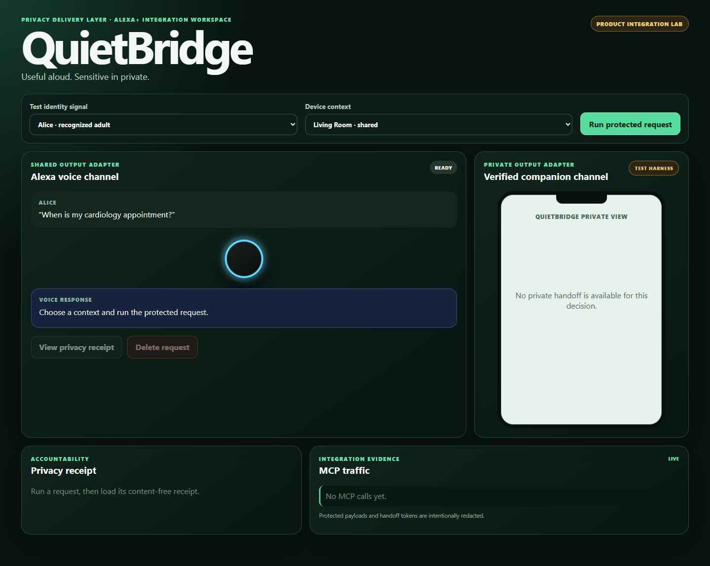
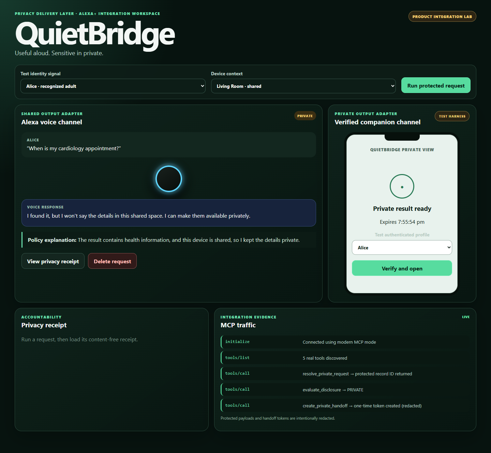

# QuietBridge

QuietBridge is a context-aware privacy control plane for an Alexa+ shared-space
experience. It classifies returned fields, evaluates the current audience,
routes only safe content to public speech, creates a short-lived private
handoff, explains the privacy decision, records a redacted receipt, and reports
deletion outcomes honestly.

The product is connector- and channel-independent: an existing calendar, health,
commerce, or account service plugs into the server-side connector contract while
Alexa+, another assistant, or an application consumes the real MCP interface.
The included integration workspace uses invented Alexa, identity, phone, and
calendar adapters to demonstrate the complete product without customer data.



## Submission evidence

- [Devpost submission copy](SUBMISSION.md)
- [Three-minute demo script](docs/demo-script.md)
- [Submission checklist](docs/submission-checklist.md)
- [Verification matrix](docs/verification-matrix.md)

The second captured flow shows the product choosing a private handoff instead
of speaking protected values in a shared room:



## Requirements

- Node.js 22 or later
- npm 11 or later

## Run

```bash
npm install
npm run quality
npm run test:e2e
npm run dev
```

Open `http://127.0.0.1:5173`. The development command runs both the MCP
server and integration workspace. Use `npm start` when only the development MCP
server is needed. `npm run build` compiles both the deployable server and the
lazy-loaded production UI; `npm start:prod` runs the compiled server.

The MCP endpoint is `http://localhost:3100/mcp`. The server supports the modern
2026-07-28 MCP protocol and 2025-era Streamable HTTP compatibility through the
official SDK handler.

## Optional AWS Bedrock classifier

QuietBridge can use Amazon Bedrock to classify the metadata of fields that are
not in its deterministic sensitivity map. The model receives the field path,
source name, and record type only—never the field value. The policy engine
remains authoritative: Bedrock cannot downgrade an unknown field to public,
and any error or low-confidence result remains fail-closed as personal data.

See [docs/aws-bedrock-setup.md](docs/aws-bedrock-setup.md) before enabling it.
Bedrock inference is usage-priced and is disabled in the free-only configuration.

An optional Amazon Verified Permissions adapter can provide a second,
centralized authorization check for protected results. It receives an opaque
SHA-256 profile identifier and audience metadata, not protected values. A
remote allow never relaxes the deterministic local decision; deny, error, or
invalid response blocks the request. See
[docs/aws-verified-permissions.md](docs/aws-verified-permissions.md).
Verified Permissions is also disabled in the free-only configuration.

## Free encrypted local handoff storage

By default, private handoffs remain in memory. For restart-safe local demos without
paid services, QuietBridge also includes an AES-256-GCM encrypted file store. It
persists token hashes rather than raw tokens, filters authentication secrets before
storage, detects tampering, and preserves one-time consumption and revocation state.

See [docs/local-encrypted-storage.md](docs/local-encrypted-storage.md). Keep the key
outside source control; `.env`, `.quietbridge/`, and `*.enc.json` are ignored.

## Privacy guarantees under test

1. Sensitive values never enter public output.
2. Unknown classification fails closed.
3. A private handoff is profile-bound, short-lived, and one-time.
4. Explanations and receipts contain categories and reasons, not hidden values.
5. Deletion status distinguishes local success from connector success.
6. Optional model assistance never receives protected field values and can only
   strengthen, not weaken, an unknown field's category.
7. Browser flows, deletion, MCP evidence, and serious/critical accessibility
   violations are covered by Playwright and axe.

## Productization and integration

- [Product architecture and technical differentiation](docs/product-architecture.md)
- [Connector, identity, channel, and container integration](docs/integration-guide.md)
- [Security controls and measurable quality gates](docs/security-and-quality.md)
- [Three-minute working-product demonstration](docs/demo-script.md)

Production mode is deliberately fail-closed. It requires authenticated MCP/private
access, encrypted handoff persistence, trusted hosts, and allowed origins at startup.
The repository is publishable as an open-source product and integration reference;
the remaining real-customer deployment responsibilities are stated explicitly rather
than hidden behind demo claims.

See [quietbridge-build-and-test-plan.md](quietbridge-build-and-test-plan.md) for
the complete architecture and submission plan.

Current implementation truth, remaining limitations, and the verification evidence are in:

- [docs/implementation-status.md](docs/implementation-status.md)
- [docs/verification-matrix.md](docs/verification-matrix.md)
- [docs/friction-log.md](docs/friction-log.md)
